# Työjono 8c pilotti: fy3-13 ennen ja jälkeen (2026-11-16)

Esimerkki 1 kaikki vaiheet auki ja tehtävän 4-16 (fy3-13-L2-07) ratkaisu auki, 390 ja 1280 px, kolme kieltä. Vain kappalejako muuttui: sanat, luvut, merkit ja yksiköt ovat samat.

## fi

### esimerkki, 390 px

| Ennen | Jälkeen |
| --- | --- |
| 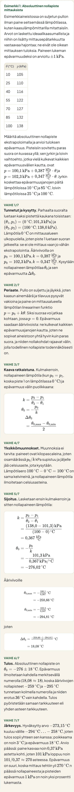 | 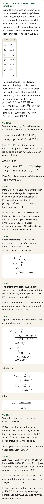 |

### esimerkki, 1280 px

| Ennen | Jälkeen |
| --- | --- |
| 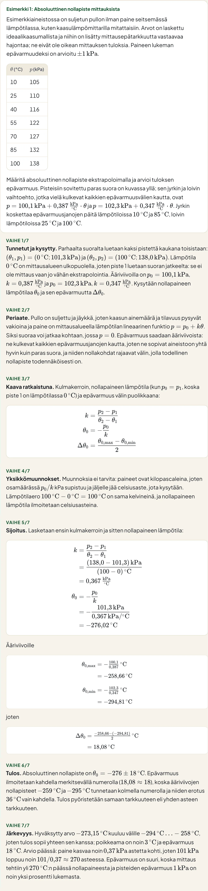 | 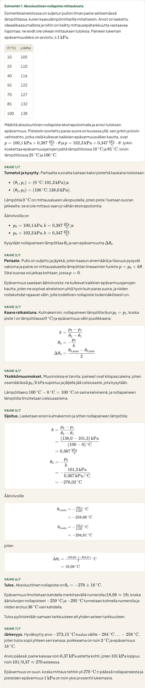 |

### ratkaisu-L2-07, 390 px

| Ennen | Jälkeen |
| --- | --- |
| 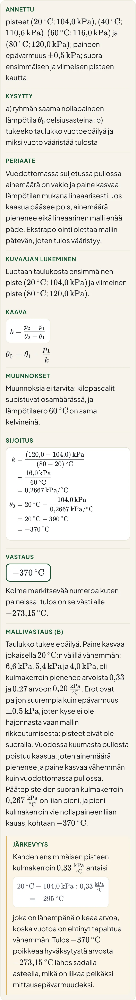 | 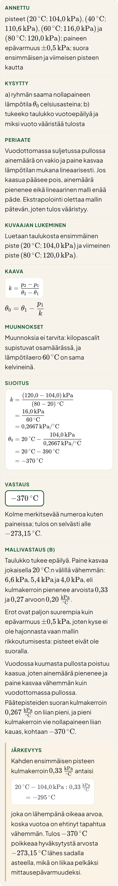 |

### ratkaisu-L2-07, 1280 px

| Ennen | Jälkeen |
| --- | --- |
| 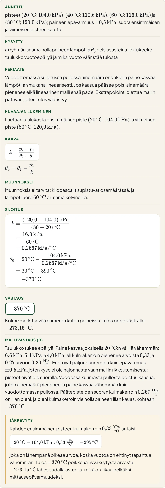 | 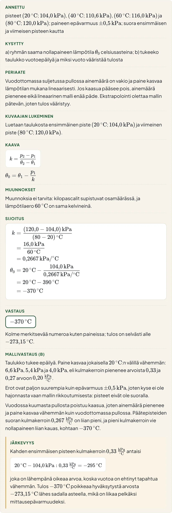 |

## en

### esimerkki, 390 px

| Ennen | Jälkeen |
| --- | --- |
| 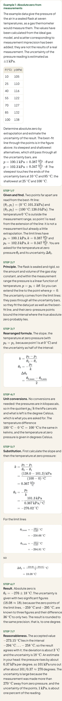 | 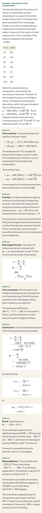 |

### esimerkki, 1280 px

| Ennen | Jälkeen |
| --- | --- |
| 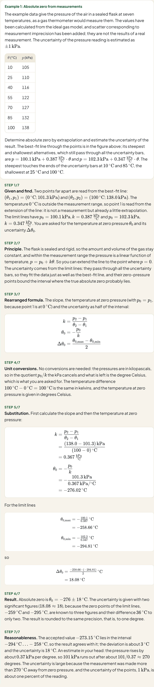 | 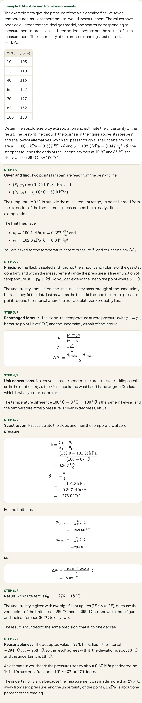 |

### ratkaisu-L2-07, 390 px

| Ennen | Jälkeen |
| --- | --- |
| 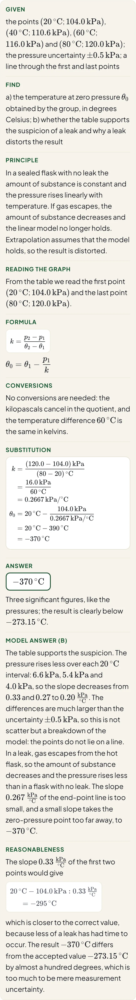 | 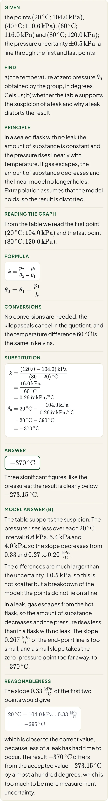 |

### ratkaisu-L2-07, 1280 px

| Ennen | Jälkeen |
| --- | --- |
| 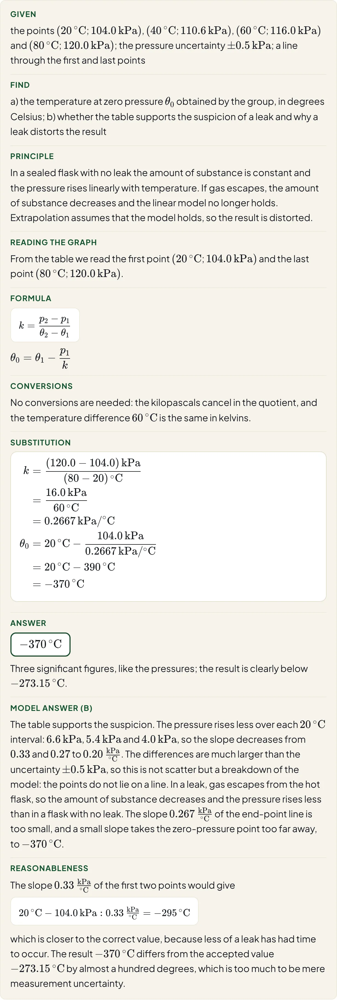 | 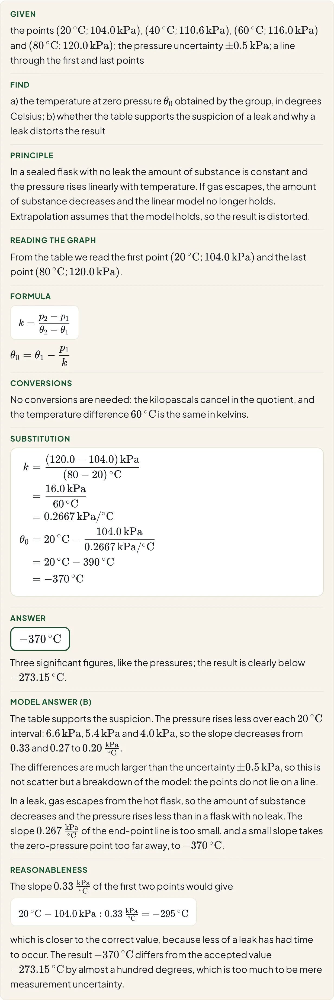 |

## fi-easy

### esimerkki, 390 px

| Ennen | Jälkeen |
| --- | --- |
| 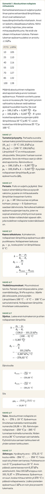 | 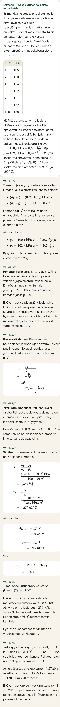 |

### esimerkki, 1280 px

| Ennen | Jälkeen |
| --- | --- |
| 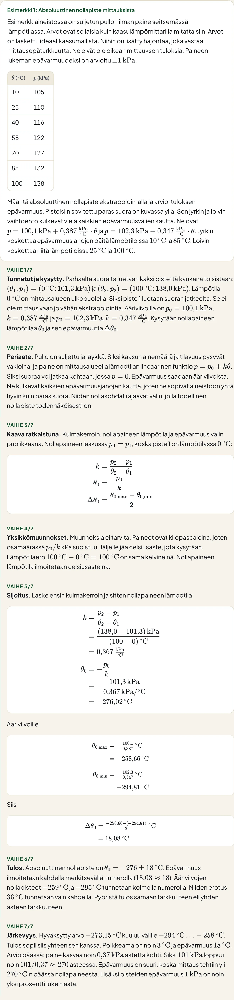 | 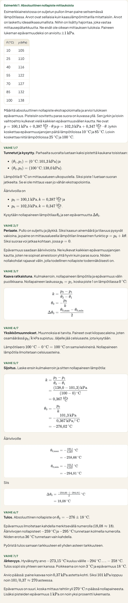 |

### ratkaisu-L2-07, 390 px

| Ennen | Jälkeen |
| --- | --- |
| 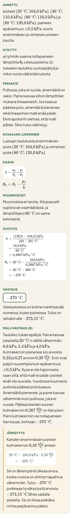 | 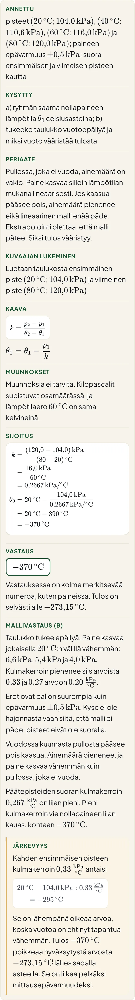 |

### ratkaisu-L2-07, 1280 px

| Ennen | Jälkeen |
| --- | --- |
| 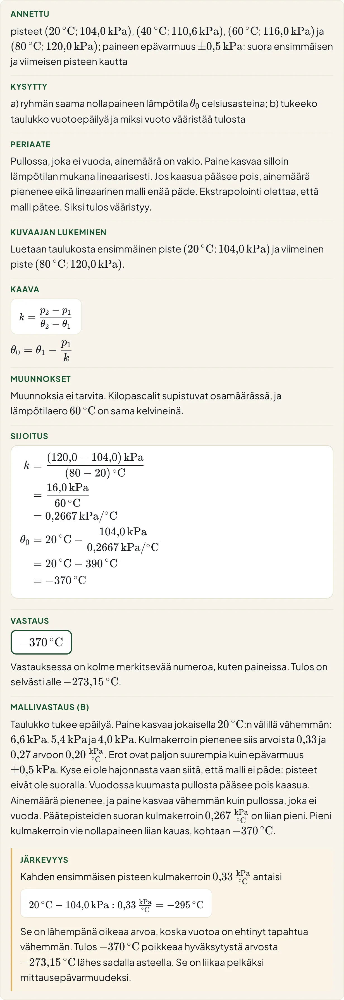 | 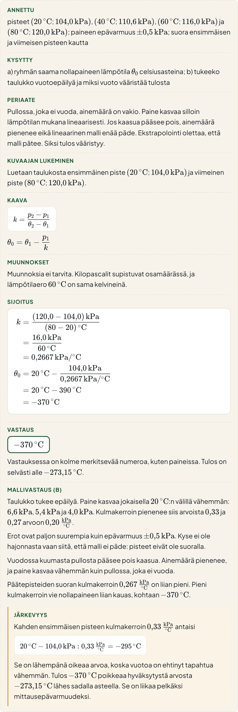 |
