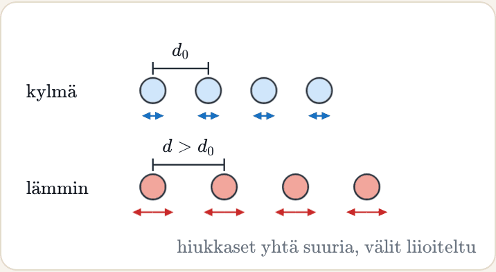
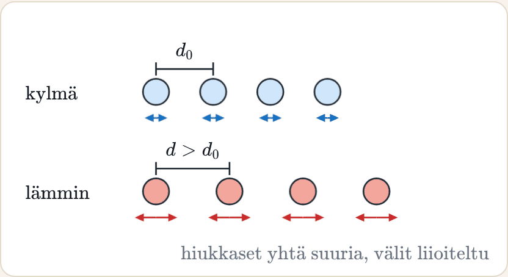
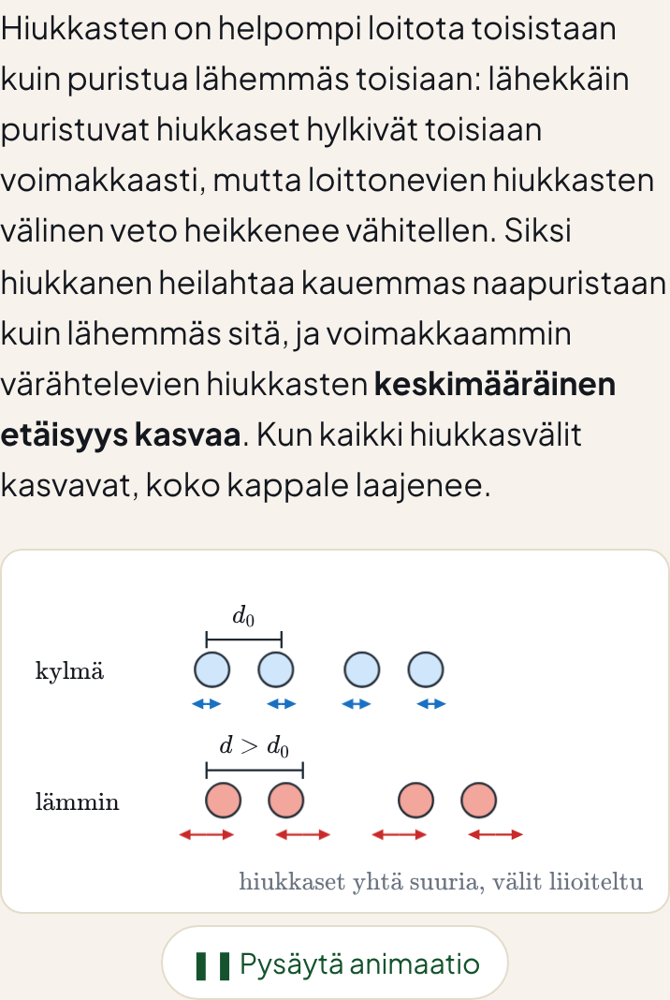
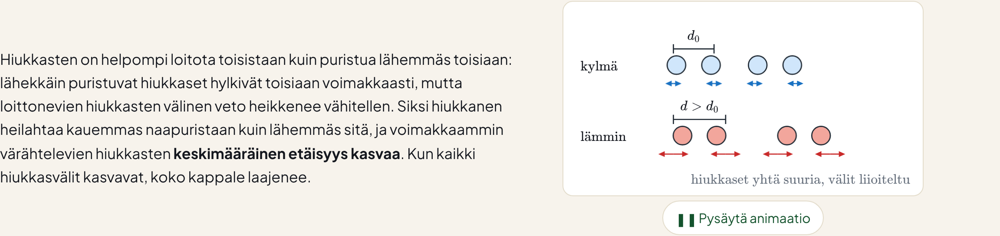
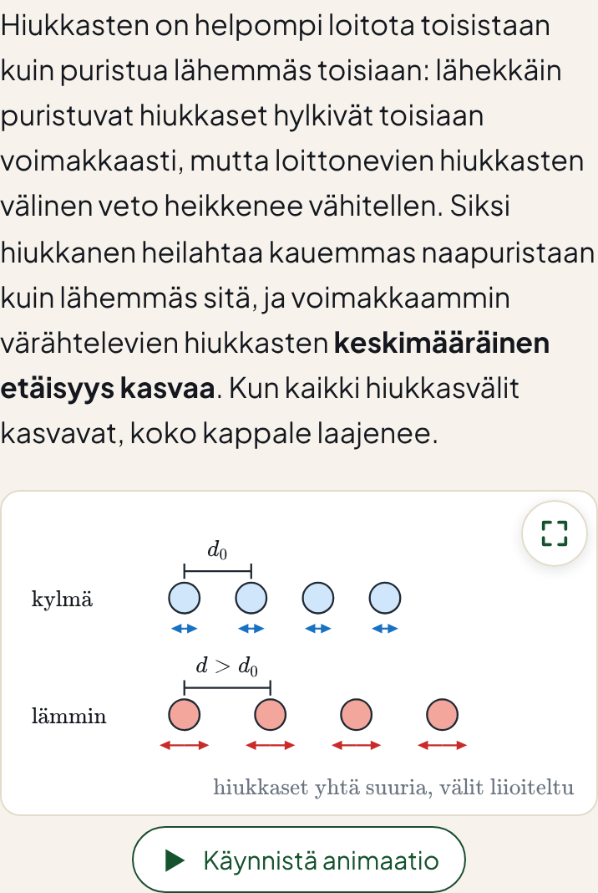
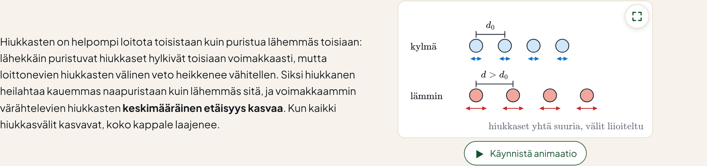
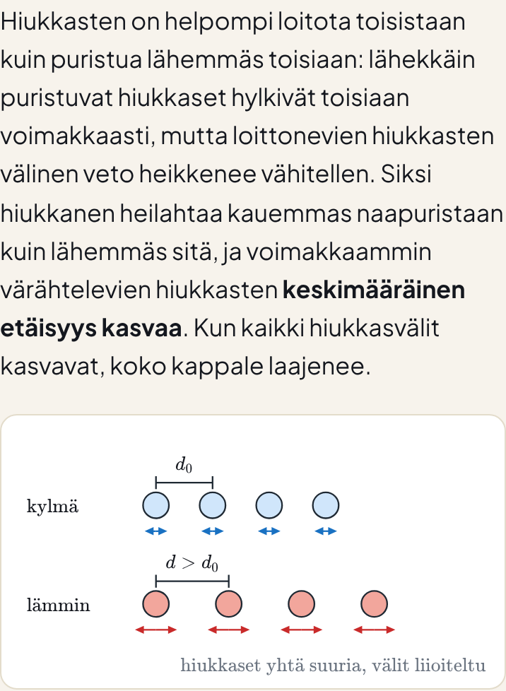
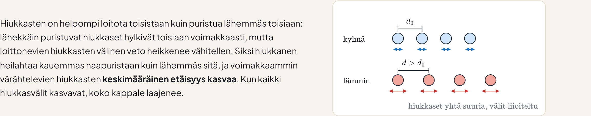

# Työjono 8f, pilotti: fy3-8:n hiukkaskuva animaationa (2026-11-16)

Luku *Lämpölaajeneminen*, kohta "Miksi aine laajenee?". Kuvan "kylmä / lämmin, d₀ / d > d₀" tilalla on nyt
loopattava animaatio. Odottaa opettajan hyväksyntää; hyväksyntää ei ole kirjattu `docs/teacher-figures.tsv`:hen.

## Mitä animaatio näyttää
- Jokainen hiukkanen värähtelee tasapainoasemansa ympärillä, ja naapurit liikkuvat vastakkaisiin suuntiin.
  Värähdyksen jakso on kummassakin rivissä sama, 2 s.
- Kylmässä rivissä amplitudi on ±6 ja tasapainoväli d₀ = 70 (kuvan yksikköä). Lämpimässä rivissä amplitudi on
  ±18 ja tasapainoväli d = 90.
- Lähin etäisyys on kummassakin rivissä melkein sama: 58 kylmässä ja 54 lämpimässä. Suurin etäisyys kasvaa paljon,
  82:sta 126:een. Näin kuva näyttää tekstin väitteen: hiukkaset loittonevat helpommin kuin puristuvat lähemmäs,
  joten keskimääräinen väli kasvaa.
- Hiukkaset pysyvät samankokoisina. Merkintä "hiukkaset yhtä suuria, välit liioiteltu" on ennallaan.
- Kun animaatio on pysäytetty, kuva on täsmälleen sama kuin nykyinen still-kuva. Geometria, nuolet ja tekstit ovat
  ennallaan, ja ainoa lisäys on liikkuvat ryhmät.

## Kaappaukset (deviceScaleFactor 2)
| | 390 px | 1280 px |
|---|---|---|
| Animaatio, yksi jakso (GIF) |  |  |
| Käynnissä, painike ❚❚ Pysäytä animaatio |  |  |
| Pysäytetty, painike ▶ Käynnistä animaatio |  |  |
| `prefers-reduced-motion: reduce`: still-kuva, ei painiketta |  |  |

## Toteutus (yhteinen komponentti)
- `scripts/figlib.py`: `Fig(..., anim=True)` ja `f.vibrate(amp, phase, period)` … `f.end()`. Kuva piirretään
  still-kuvana. Liike on CSS-animaatio (`templates/site.css`, "Animated figures"), eikä siinä ole JavaScript-silmukkaa
  tai canvasia.
- `templates/lesson.js` osa 7b lisää kuvan alle ▶/❚❚-painikkeen (WCAG 2.2.2). Se käynnistää animaation vain, kun
  kuva on näkyvissä (IntersectionObserver). Painike ei näy, kun `prefers-reduced-motion` on päällä.
- Still-kuva näkyy myös ilman JavaScriptiä, tulosteessa, PDF-vihkoissa (print_book.py tulostaa sivun) ja
  suurennetussa kuvassa.
- Muut luvut voivat käyttää samaa komponenttia (esim. kaasun paine, faasimuutokset), mutta vasta kun opettaja on
  hyväksynyt tämän pilotin.
