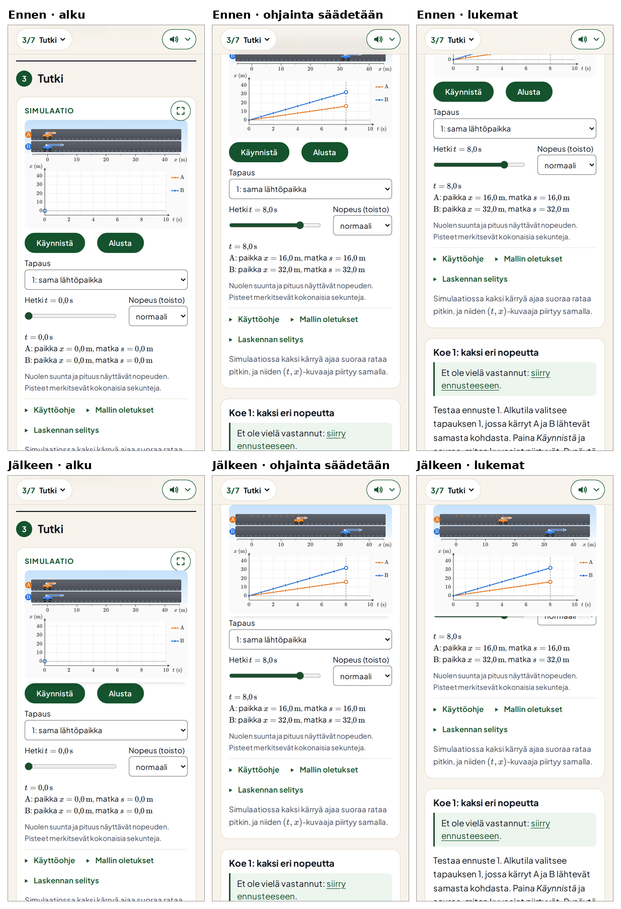
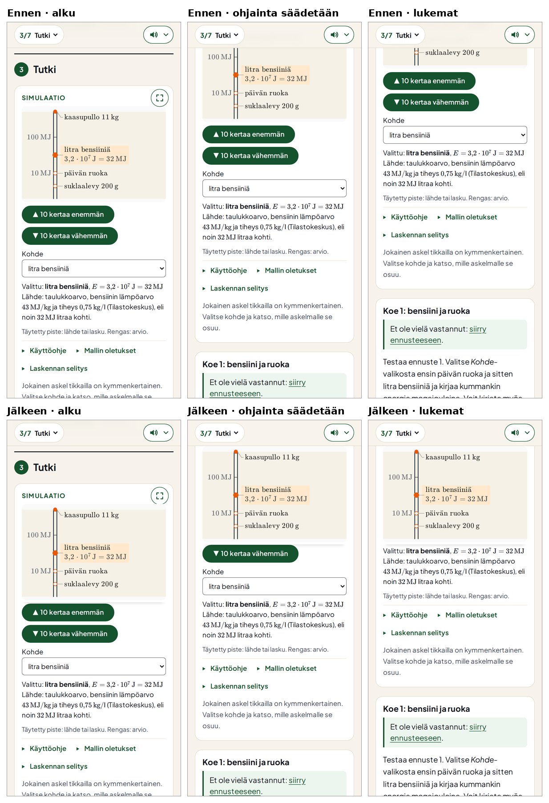

# Tarttuva simulaatiokuva puhelimella: pilotti (työjono 10, PR 4)

Opettajan hyväksyttäväksi 16.11.2026. Muistio: `docs/audits/2026-11-14-simulaatioiden-kayttoliittyma.md`, päätös
"Puhelimella kuva tarttuu vaihepalkin alle; pilotti ensin".

## Mitä muuttuu

Puhelimella (ikkuna enintään 600 px leveä ja vähintään 544 px korkea) simulaation kuva jää vaihepalkin ("3/7 Tutki")
alle, kun opiskelija vierittää alaspäin ohjaimiin ja lukemiin. Näin säädön vaikutus näkyy kuvassa samalla, kun
ohjainta käytetään. Kuva irtoaa simulaatiokortin lopussa (laatikoiden Käyttöohje, Mallin oletukset ja Laskennan
selitys jälkeen) eikä peitä kokeita. Ohjaimet, jotka kulkevat kuvan alta, tulevat takaisin näkyviin vierittämällä
ylöspäin.

Pilottisivut: **fy4-1** (aikaohjattu, tyyppi A) ja **fy2-2** (staattinen, `STATIC`-listalla, tyyppi C). Muilla
sivuilla mikään ei muutu ennen hyväksyntää (testi tarkistaa myös tämän). Ei muutu: työpöytä ja tabletti, vaakasuuntainen
puhelin (kuvalle ei jää tilaa), Suurenna-tila, sim.js-tiedostot, simulaatioiden tekstit ja fysiikka.

## Ennen ja jälkeen, 390 × 844 px

Kolme kuvaa samasta vierityskohdasta ennen ja jälkeen: kortin alku, ohjainta säädetään (fy4-1: Käynnistä ja hetki-liuku
8,0 s:iin; fy2-2: "10 kertaa enemmän" kahdesti) ja lukemat näkyvissä.

| | Kuva näkyvissä: ohjainta säädetään | Kuva näkyvissä: lukemat |
|---|---|---|
| fy4-1 ennen | 77 % | 21 % |
| fy4-1 jälkeen | 100 % | 100 % |
| fy2-2 ennen | 77 % | 21 % |
| fy2-2 jälkeen | 100 % | 100 % |

### fy4-1

### fy2-2

## Toteutus

- `scripts/inquiry.py`: `SIM_STICK_PILOT = {"fy4-1", "fy2-2"}` antaa simulaatiopalstalle luokan `sim-stick`.
- `templates/site.css`: `@media (max-width:37.5rem) and (min-height:34rem)`: `.sim-stick` -kortin kuva
  `position: sticky` vaihepalkin alle, valkoinen tausta ja kevyt varjo alareunassa.
- `templates/lesson.js`: vaihepalkin korkeus muuttujaan `--toc-h` vain sivulla, jolla on `.sim-stick`.
- `scripts/test_inquiry.py` (`stick_checks`): 390 × 844 ja 360 × 740 px: pilottisivulla kuva on kokonaan näkyvissä
  heti vaihepalkin alla, kun lukemat ovat sen alla; muilla sivuilla kuva ei tartu.

## Yleistys hyväksynnän jälkeen

Luokka kaikille `sim-card2`-korteille (inquiry.py), testin ehto kaikille. Ennen sitä mitataan korkeat kuvat:
puhelimella esimerkiksi fy7-4:n kuva on 551 px, jolloin tarttuva kuva jättäisi ohjaimille liian vähän tilaa. Niille
tarvitaan raja (kuva tarttuu vain, jos se vie enintään noin puolet ikkunasta) tai ne jätetään pois.
