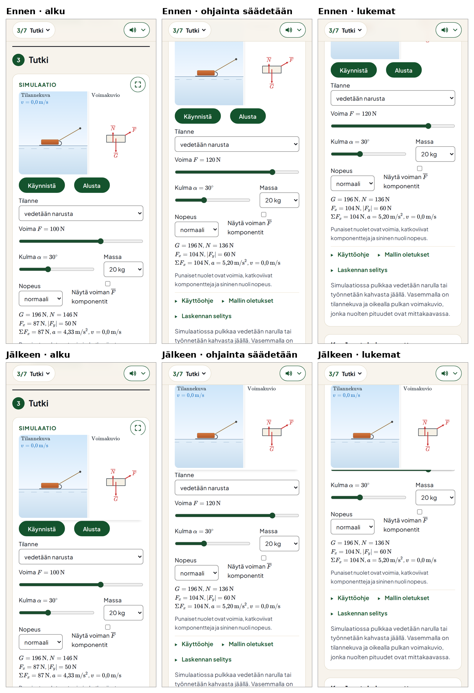
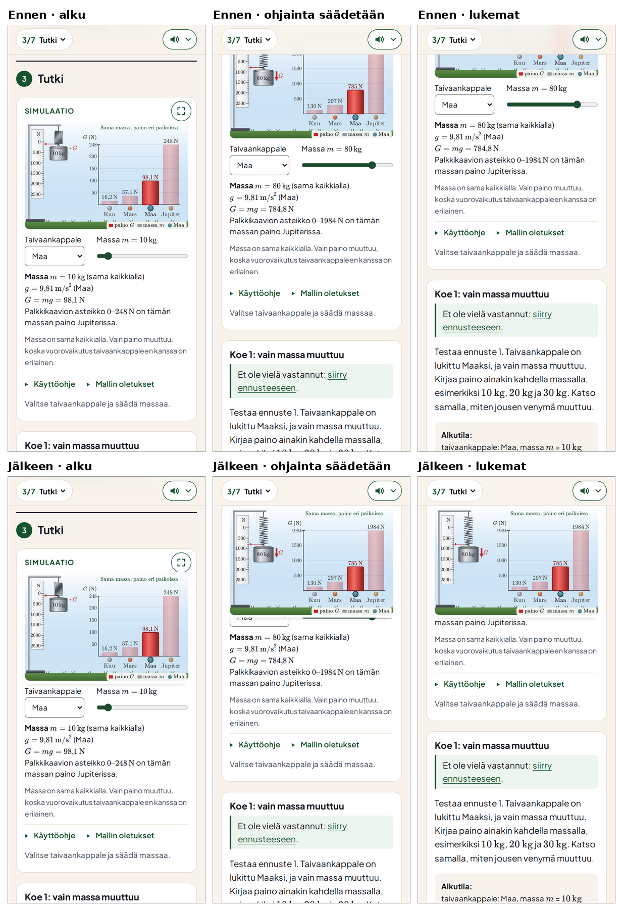
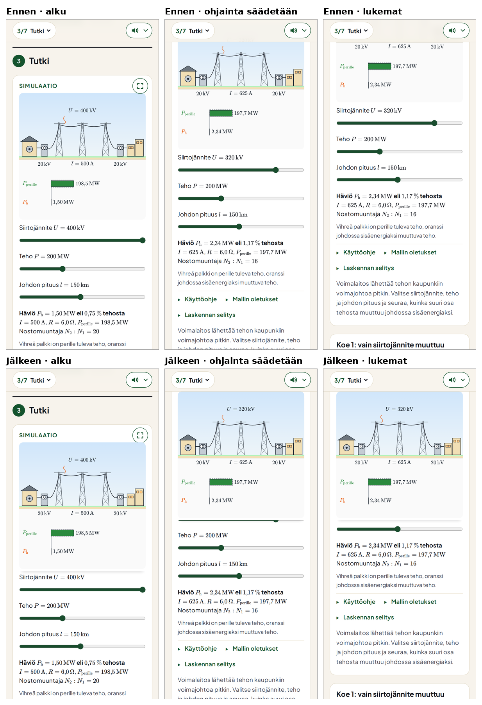
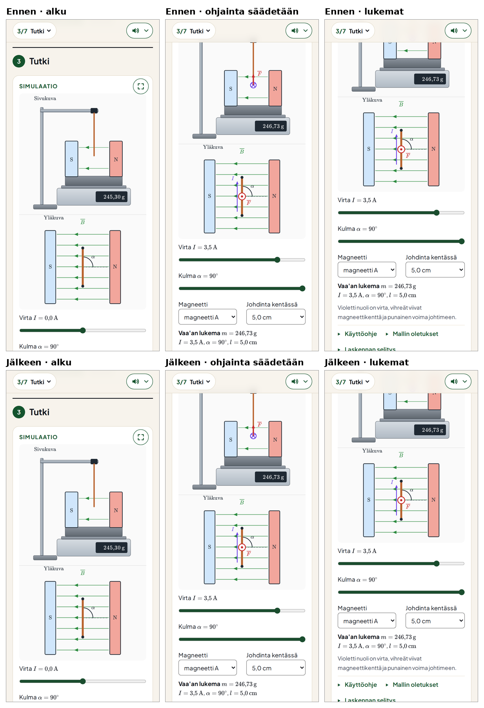

# Tarttuva simulaatiokuva puhelimella kaikkiin simulaatioihin (työjono 10, PR 4b)

Jatkoa pilotille (#648, `docs/audits/2026-11-16-sim-pr4-tarttuva-kuvat/`), jonka opettaja hyväksyi 16.11.2026
("Hyväksyn"). Pilotin tapaan puhelimella (ikkuna enintään 600 px leveä ja vähintään 544 px korkea) simulaation kuva
jää vaihepalkin alle, kun opiskelija vierittää ohjaimiin ja lukemiin, ja irtoaa kortin lopussa. Nyt se koskee kaikkia
96 simulaatiota, ja korkeille kuville on raja.

## Korkeusraja: 45 % (opettaja 17.11.2026)

Kuva tarttuu vain, jos se vie enintään **45 %** ikkunan korkeudesta vaihepalkin alla. Ohjaimille jää siis aina
vähintään 55 % (390 × 844: kuva enintään 354 px; 360 × 740: kuva enintään 307 px). Korkeampi kuva pysyy paikallaan
kuten ennenkin, joten se ei peitä ohjaimia. Ensimmäinen ehdotus oli 55 % (67 simulaatiota 390 px:llä); opettaja
valitsi 45 %, jotta kuvan alla olevat painikkeet (Käynnistä, Alusta) eivät jää ison kuvan alle.

| Ikkuna | Tarttuu | Ei tartu (korkea kuva) |
|---|---|---|
| 390 × 844 | 48 / 96 | 48 (esim. fy4-3 400 px, fy7-4 551 px, fy4-13 724 px, tyypin D fy6-5, fy6-9, fy6-13, fy6-14) |
| 360 × 740 | 47 / 96 | 49 |

Raja lasketaan sivulla (`lesson.js`) kuvan todellisesta korkeudesta, joten se seuraa myös ikkunan koon muutosta.

## Ennen ja jälkeen, 390 × 844 px

Kuvat samasta vierityskohdasta: kortin alku, ohjainta säädetään (180 px alempana) ja lukemat (300 px alempana).
"Ennen" on `main` ennen tätä muutosta (tarttuminen vain pilottisivuilla fy4-1 ja fy2-2).

| Simulaatio | Tyyppi | Kuva | Kuvasta näkyvissä lukemia luettaessa: ennen → jälkeen |
|---|---|---|---|
| fy4-5 | aikaohjattu | 216 px | 22 % → 100 % |
| fy3-1 | jatkuva (FY3) | 216 px | 21 % → 100 % |
| fy7-8 | staattinen | 324 px | 48 % → 100 % |
| fy7-4 | korkea | 551 px | 69 % → 69 % (ei tartu, raja) |

### fy4-5 (aikaohjattu)

### fy3-1 (jatkuva)

### fy7-8 (staattinen)

### fy7-4 (korkea: ei tartu)

## Toteutus

- `scripts/inquiry.py`: luokka `sim-stick` jokaiselle simulaatiopalstalle; `SIM_STICK_OFF` (tyhjä) jättää luvun pois
  syineen, `SIM_STICK_SHARE = 0.45`.
- `templates/lesson.js`: vaihepalkin korkeus `--toc-h`:ksi ja luokka `sim-fits` #sim:lle, kun kuva mahtuu rajaan.
- `templates/site.css`: sticky vain `.sim-stick #sim.sim-fits` -korteissa, ei Suurenna-tilassa.
- `scripts/test_inquiry.py` `stick_checks` jokaiselle simulaatiosivulle 390 × 844 ja 360 × 740: rajaan mahtuva kuva
  tarttuu kokonaan palkin alle, korkeampi pysyy paikallaan. Kaikki 96 sivua tarkistettu CI:n kontissa.
